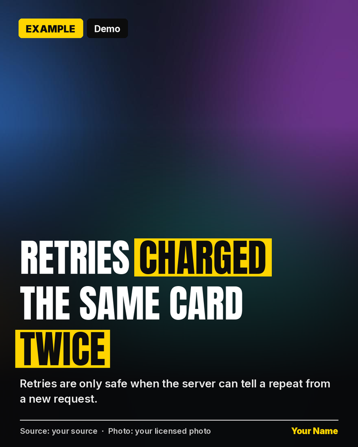
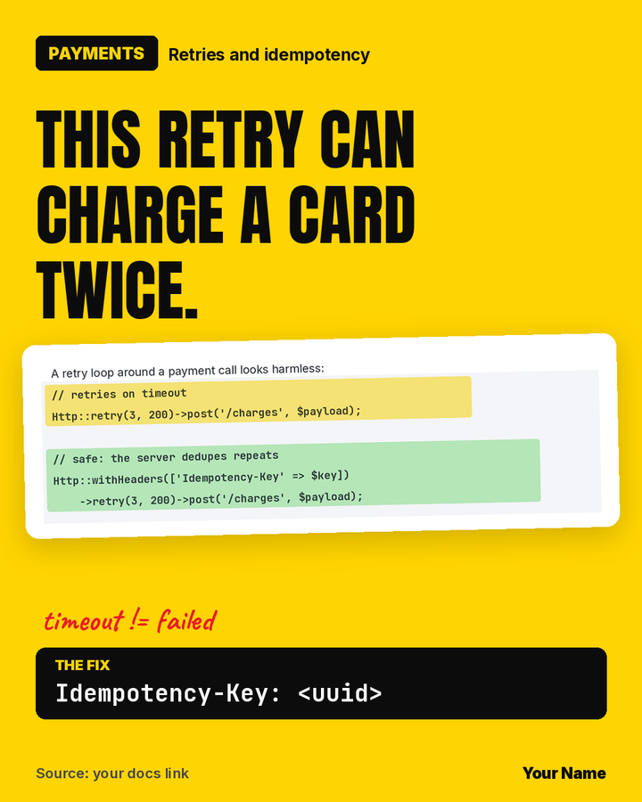
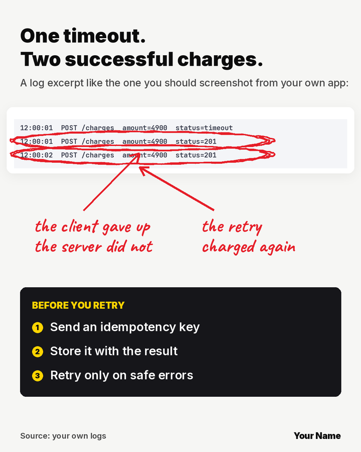
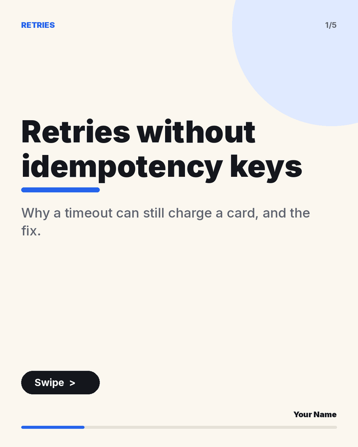
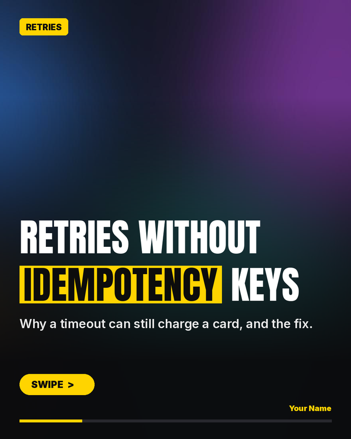
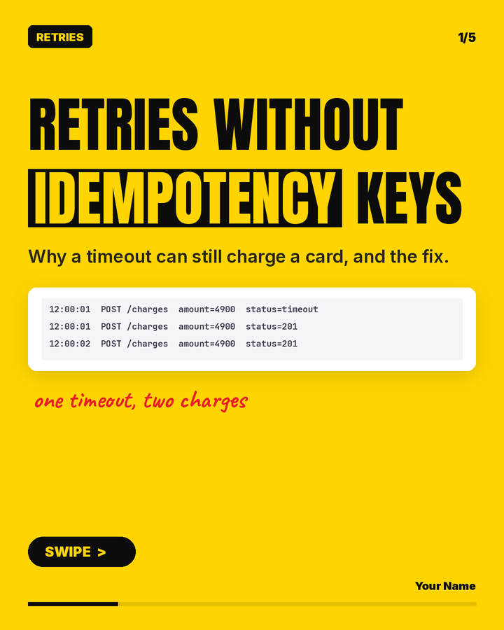

# linkedin-post-skill

An agent skill that drafts **one research-backed LinkedIn post at a time** (image, video or PDF carousel), lints the caption for AI-sounding writing, and hands it to **you** to approve. It never posts on a schedule.

It works with Claude (as a `SKILL.md` skill) or any agent that can read a markdown playbook and run Python.

<p align="center">
 &nbsp;
 &nbsp;

</p>
<p align="center">
 &nbsp;
 &nbsp;

</p>

## Why

Most "LinkedIn automation" optimises for volume. This optimises for credibility and for people actually reading on a phone:

- **Lanes by weekday** (news take, first-person story, practical checklist) so you do not repeat yourself
- **Integrity rules**: no invented numbers, clients or anecdotes; sources ranked; every fact verified or labelled
- **Visual Rotation**: six templates picked at random (real-photo news card, highlighted screenshot card, annotated proof, light carousel, text only, Neon Terminal), each available as an image or a carousel, so your feed never looks like one AI template
- **Phone-first design**: one idea per image or slide, big text, real screenshots over decoration
- **Slop lint**: catches "leverage", "it's not just X, it's Y", em dashes, links in the caption, hashtag walls
- **A human in the loop**: drafts and notifications only; you press Post

## What is inside

| Path | What it is |
|---|---|
| `skill/daily-linkedin-post/SKILL.md` | The playbook the agent follows |
| `skill/daily-linkedin-post/tools/templates.py` | Visual Rotation: `news_card`, `screenshot_card`, `proof_card`, `light_carousel`, `styled_carousel`, `capture` (real page screenshots) |
| `skill/daily-linkedin-post/tools/fetch_fonts.py` | Downloads the OFL fonts the templates use (Anton, Inter, JetBrains Mono, Caveat) |
| `skill/daily-linkedin-post/templates-demo.py` | Renders every template with demo content |
| `skill/daily-linkedin-post/tools/style.py` | "Neon Terminal" canvas (template T6): cards, pills, icon tiles, gradient text |
| `skill/daily-linkedin-post/tools/carousel.py` | JSON to 1080x1350 PDF carousel (+ cover PNG) |
| `skill/daily-linkedin-post/tools/slop_lint.py` | Caption linter |
| `skill/daily-linkedin-post/hook-formulas.md` | Hook patterns with failure modes |
| `skill/daily-linkedin-post/example-post.py` | Minimal single-image example |
| `templates/state/` | Starter `history.jsonl`, `ideas.json`, `config.example.json`, `voice.md` |
| `examples/` | Example `slides.json` and `caption.txt` |
| `docs/` | Usage, workflow, customising, safety |

## Quick start (5 minutes)

```bash
git clone https://github.com/<you>/linkedin-post-skill.git
cd linkedin-post-skill
bash setup.sh                      # Python deps, fonts, Lucide icons (needs python3, pip, npm)

# 0. render every template (news card, screenshot card, proof card, 3 carousel styles)
LI_NAME="Your Name" python3 skill/daily-linkedin-post/templates-demo.py demo-out

# 1. make a single image (Neon Terminal)
LI_NAME="Your Name" LI_HANDLE="Your headline" python3 skill/daily-linkedin-post/example-post.py

# 2. make a carousel
python3 skill/daily-linkedin-post/tools/carousel.py examples/slides.json out.pdf

# 3. lint a caption
python3 skill/daily-linkedin-post/tools/slop_lint.py examples/caption.txt
```

Then give the agent the skill: copy `skill/daily-linkedin-post/` into your agent's skills folder, copy `templates/state/` to a writable folder, and fill in `voice.md`. Full steps: [docs/USAGE.md](docs/USAGE.md).

## Documentation
- [docs/USAGE.md](docs/USAGE.md): install, first run, carousel JSON format, caption rules, linter
- [docs/WORKFLOW.md](docs/WORKFLOW.md): the weekly flow, scheduled drafts, approving and posting by hand
- [docs/CUSTOMIZING.md](docs/CUSTOMIZING.md): your lanes, pillars, voice, colours, signature, new slide types
- [docs/safety-and-tos.md](docs/safety-and-tos.md): why it never auto-posts, and what never goes in a public repo

## Contributing
Issues and pull requests are welcome. See [CONTRIBUTING.md](CONTRIBUTING.md).

## Licence and credits
MIT. See [LICENSE](LICENSE) and [NOTICE](NOTICE). Lucide icons (ISC) and the fonts (SIL OFL) are downloaded by `setup.sh`, not bundled. Brand logos belong to their owners.
